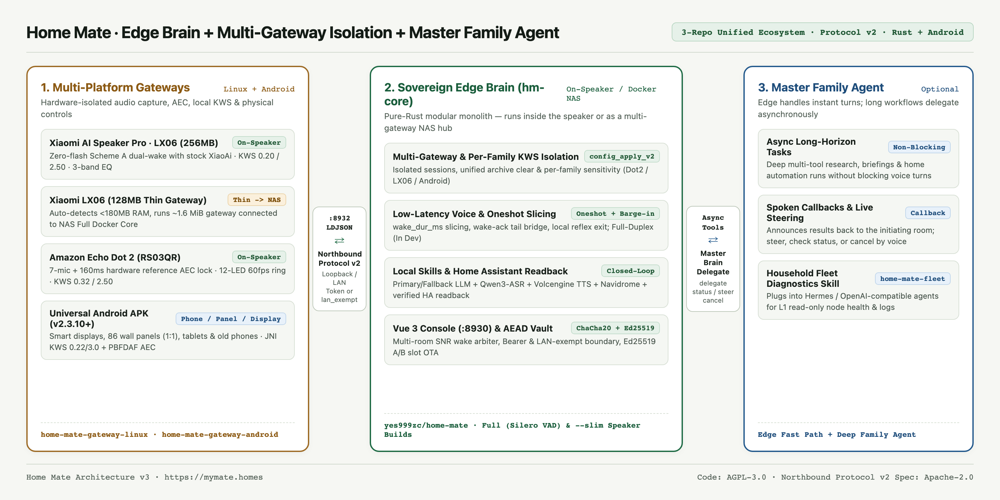

<div align="center">
  <h1>Home Mate Linux Device Gateway</h1>
  <p>
    <strong>Unified Feature-Gated Rust Hardware Voice Gateway for Embedded Linux Smart Speakers</strong>
  </p>
  <p>
    <em>Consolidates Echo Dot 2 (<code>board-dot2</code>) and Xiaomi AI Speaker Pro LX06 (<code>board-lx06</code>, adaptive 256 MB on-speaker / 128 MB thin mode) into one clean Rust hardware gateway over Northbound Protocol v2.</em>
  </p>
  <p>
    <a href="README.md"><strong>English</strong></a> ·
    <a href="README.zh-CN.md">简体中文</a> ·
    <a href="https://mymate.homes">Official Website (mymate.homes)</a>
  </p>
  <p>
    
    
    
    
  </p>
</div>

> [!NOTE]
> **Unified Repository Announcement**: This repository officially merges and supersedes the earlier separate `home-mate-gateway-dot2` and `home-mate-gateway-lx06` repositories. All Echo Dot 2 and Xiaomi LX06 (256 MB & 128 MB) builds, acoustic fixes, and AI deployment scripts now live here.

---

## Ecosystem & Architecture Boundary

<p align="center">
  
</p>

This repository is the **Linux Embedded Multi-Board Hardware Gateway** in the unified 3-repository **Home Mate** ecosystem:

| Repository | Role | Connection |
| :--- | :--- | :--- |
| **[`yes999zc/home-mate`](https://github.com/yes999zc/home-mate)** | Sovereign Edge Brain (`hm-core`, full & `--slim` builds) + Vue 3 Web Console + Master Brain Agent delegation + Docker/NAS | Listens on Northbound v2 TCP `:8932` (loopback on device, or private LAN in Docker/NAS mode) |
| **`yes999zc/home-mate-gateway-linux`** *(this repo)* | Unified Linux multi-board hardware voice gateway | Owns ALSA capture/playback, multi-mic SpeexDSP AEC, local KWS sidecar (`wake_dur_ms` oneshot + local exit), LED rings, buttons, and non-invasive supervisors |
| **[`yes999zc/home-mate-gateway-android`](https://github.com/yes999zc/home-mate-gateway-android)** | Universal adaptive Android APK client & voice gateway | Connects smart displays, 4-inch 86 wall panels, tablets, phones & spare old phones over LAN/Tailscale |

**Strict Hardware & Acoustic Isolation**:
- `hm-core` never embeds board drivers; Linux speakers live behind the `Hardware` trait, `DeviceProfile`, and Cargo board feature flags (`board-dot2`, `board-lx06`) with zero cross-board binary bloat.
- **Per-family KWS isolation & `config_apply_v2`**: Hardware families are isolated cleanly so tuning one room never breaks another — **LX06** (`0.20 / 2.50`) and **Android** (`0.22 / 3.00`) carry dedicated hardware-class defaults, while **Dot2** ships with code/sidecar default `0.25 / 3.00` (and calibrated Dot2 field baseline `0.32 / 2.50`). Runtime KWS/EQ/LED/acoustics updates flow over Northbound **`config_apply_v2`** with deferred KWS reload receipts (`Persisted` -> `Active` only after `hm-kws` reports `ready`, 20 s monotonic timeout). Physical unit acoustics (volume cap, mix levels, VAD thresholds) are calibrated per unit and never copied across devices.
- **Responsive Voice Pipeline**: Supports oneshot `wake_dur_ms` command slicing, wake-ack tail bridging, deterministic local reflex exit (`退下吧` / `停止播放` — emits `LocalExitFlushed` strictly before the retreat `Keyword` frame when playback is active), and mid-playback wake-word interruption (everyday default is half-duplex; Full-Duplex is in active development).

---

## Supported Device Targets (3 Adaptive Deployment Modes)

Before deploying to a Xiaomi AI Speaker Pro (`LX06`), always run `free -m` or `grep ^MemTotal /proc/meminfo` over SSH first — Xiaomi shipped **both 256 MB and 128 MB RAM hardware batches** under the same `LX06` model name.

| Target | Board / RAM | Architecture & Cargo Feature | Runtime Topology | Core Location & Link |
| :--- | :--- | :--- | :--- | :--- |
| **1. Amazon Echo Dot 2 (`dot2`)** | Echo Dot 2 (`AEOBC` / `RS03QR`), 512 MB RAM | `armv7-unknown-linux-musleabihf`<br/>`board-dot2` *(default)* + `clock32` | Full on-device sovereign runtime: Full `hm-core` + `hm-gateway` + local `hm-kws` (code default `0.25/3.00`; calibrated Dot2 baseline `0.32/2.50`), 7-mic + ch8 loopback AEC, 12-LED IS31FL3236 ring, A/B slot OTA | **On-device** full `hm-core` over loopback `127.0.0.1:8932` |
| **2. Xiaomi AI Speaker Pro `LX06` 256 MB (`lx06-256m`, Verified)** | `LX06` (`MemTotal >= 180,000 kB`, ~241 MiB RAM, `/tmp` ~120 MiB) | `aarch64-unknown-linux-musl`<br/>`--no-default-features --features board-lx06` | Full on-device dual-wake runtime: `hm-core --slim` + `hm-gateway` + `hm-kws` (`0.20/2.50`, `gateway_vad`), Storage Scheme A (`/data` -> `/tmp`, zero SquashFS edits), coexists with stock XiaoAi | **On-device** `hm-core --slim` over loopback `127.0.0.1:8932` |
| **3A. Xiaomi `LX06` 128 MB Thin Gateway *(Experimental · w/ NAS)*** | `LX06` 128 MB batch (`MemTotal < 180,000 kB`, ~118 MB RAM, `/tmp` ~59 MiB) | `aarch64-unknown-linux-musl`<br/>`--no-default-features --features board-lx06` | Experimental gateway-only thin client: `hm-lx06-thin.tar.xz` (~607 KB compressed), no local `hm-core` or `hm-kws`, zero SquashFS edits *(not yet verified on physical 128 MB hardware)* | **LAN NAS / Server running Full Docker `hm-core`** (with Silero VAD, direct LAN `:8932` or SSH tunnel) |
| **3B. Xiaomi `LX06` 128 MB Standalone Pure-ASR *(Experimental · Not Recommended)*** | `LX06` 128 MB batch (`MemTotal < 180,000 kB`, no NAS/server) | `aarch64-unknown-linux-musl`<br/>`--no-default-features --features board-lx06` | Experimental on-device pure-ASR: `hm-core --slim` (`HM_VOICE_EVENTS=0`) + `hm-gateway`, **skips `hm-kws`**; RAM is extremely tight (~51 MiB free after stock XiaoAi) — prone to high load & poor wake | **On-device** `hm-core --slim` over loopback `127.0.0.1:8932` *(experimental only)* |

> **Other Xiaomi non-Pro models**: Only **LX06 (Xiaomi AI Speaker Pro)** is built-in and verified. See [Porting a New Linux Speaker](#porting-a-new-linux-speaker) for community ports.

---

## Target-by-Target Deployment Guide

### Target 1: Amazon Echo Dot 2 (`dot2`)

- **Prerequisites (From Stock to `emOS`)**:
  1. Unlock Bootrom over Micro-USB via **[`yes999zc/firebreak`](https://github.com/yes999zc/firebreak)** (`uvx firebreak@latest`, based on `amonet`) and keep your stock `p10` backup (do NOT update stock firmware via the Alexa App first).
  2. Flash upstream **`emOS`** from **[`wilbowes/EchoMuse`](https://github.com/wilbowes/EchoMuse)** ([`emos/`](https://github.com/wilbowes/EchoMuse/tree/main/emos) directory, `emos-v0.10+`) around your device's own kernel/DTB (you can return to TWRP anytime via `/init recovery`), then run **`em-wifi`** on the USB serial console (`/dev/cu.usbmodem*` or `/dev/ttyACM*`) until `ID=emos` is online.
- **Audio & Peripherals**: 9ch `S24_3LE` 16 kHz capture (7 mics + ch8 hardware loopback reference), SpeexDSP MIMO AEC, 12× IS31FL3236 RGB ring, hardware buttons, local Sherpa-ONNX KWS sidecar (code default `0.25 / 3.00`; calibrated Dot2 field baseline `0.32 / 2.50`).
- **Build & Provision**:
  ```bash
  ./tools/build_firmware.sh
  ```
  Produces a static `armv7-unknown-linux-musleabihf` binary linked with `rust-lld` + Rust's musl `mallocng`, verified by `tools/elf_assert.py` and the 16 MiB OTA `tools/size_gate.py`. Then follow **[`yes999zc/home-mate` Track B](https://github.com/yes999zc/home-mate#track-b-amazon-echo-dot-2-rs03qr--aeobc--from-stock-to-talking)** to self-sign `home-mate-release.tar`, generate the bootstrap seed (`build_bootstrap.py`), and provision via `./tools/hm-provision.sh`.

### Target 2: Xiaomi AI Speaker Pro `LX06` — 256 MB RAM (`lx06-256m`)

- **Prerequisites**: Root SSH enabled (via [idootop/open-xiaoai](https://github.com/idootop/open-xiaoai)), `MemTotal >= 180,000 kB`, and `>= 6.0 MiB` free on `/data` (`df -h /data`).
- **Non-Invasive Storage Scheme A**: Stock `mtd4` / `mtd5` SquashFS partitions are **never touched** (zero brick risk; uninstall anytime with `rm -rf /data/hm /data/init.sh && reboot`).
- **Build & Install**:
  ```bash
  # 1. Build slim hm-core + LX06 hm-gateway + pack <= 6.0 MiB Scheme A bundle
  ./tools/pack_lx06_bundle.sh

  # 2. Serve build/lx06/hm-kws-lx06.tar.xz on a LAN HTTP server (e.g. 192.168.1.50:18089), then install:
  ./deploy/lx06/install-lx06.sh \
    --device-ip 192.168.1.10 \
    --kws-url http://192.168.1.50:18089/hm-kws-lx06.tar.xz
  ```
- **Console & Mode Switching**: Open `http://192.168.1.10:8930` (runs directly on the speaker). Long-press the Play/Pause button for 1.5 s (`lx06-switch-watch`) to toggle between dual-wake (`homemate`) and pinned stock XiaoAi (`xiaoai-pinned`).

### Target 3: Xiaomi AI Speaker Pro `LX06` — 128 MB RAM (Experimental: Thin Gateway w/ NAS or Standalone Pure-ASR)

> [!WARNING]
> **Experimental / Unverified on 128 MB Hardware — Please Lower Expectations**:
> The maintainer only owns and hardware-tests the **256 MB LX06 batch**; all **128 MB modes below are currently Experimental and have NOT been stress-tested on physical 128 MB hardware**. Stock XiaoAi already leaves only ~51 MiB of available RAM on 128 MB units, and community 128 MB testers have reported **severe lag, high CPU load, memory pressure, and degraded wake reliability (even for stock "XiaoAi")** when running alongside native XiaoAi:
> - **Option 3B (`--standalone-asr`, No NAS) is NOT recommended for daily use**: unpacking `hm-core` (~13.6 MiB) into RAM-backed `/tmp` plus runtime memory squeezes page cache to near zero and triggers flash paging/stutter.
> - **Option 3A (`--thin` + NAS)** has a much smaller RAM footprint, but `hm-gateway` still runs continuous capture/AEC alongside stock `mipns-xiaomi` without local KWS, so responsiveness and wake reliability are still noticeably below 256 MB.
> - **Honest recommendation**: For smooth LX06 dual-wake, use the **256 MB batch**; if you have a 128 MB unit and want reliable daily use without tuning, a **repurposed Android phone/tablet/86 panel + NAS Docker Core** is a much better fit. You can always return a 128 MB LX06 to 100% stock via `rm -rf /data/hm /data/init.sh && reboot`.

> **Community Credit**: Huge thanks to **[@jiantongzh](https://github.com/jiantongzh)** for hardware-validating the 128 MB LX06 batch (`MemTotal ≈ 118,760 kB`, `/tmp tmpfs ≈ 59 MB`) and contributing the initial Thin Mode design!
> **Zero-Compile Prebuilt Assets**: Starting with `v0.0.54`, GitHub Releases ships both prebuilt archives (`hm-lx06-thin.tar.xz` ~607 KB, `hm-bundle.tar.xz` ~5.0 MiB, `init.sh`, `unxz`, and `SHA256SUMS.txt`) so you can install directly without a Rust cross-compile toolchain.

#### Option 3A (Experimental, with NAS / Server): 128 MB Thin Gateway (`--thin`) + LAN Full Docker `hm-core`
Runs only `hm-gateway` on the speaker (skipping `hm-core` and `hm-kws`), paired with **Full Docker `hm-core`** (with in-process Silero neural VAD — never `--slim`) on your LAN NAS/server:

```bash
# 1. Start standard FULL Docker hm-core on your NAS/server (HM_GATEWAY_ALLOW_LAN=1; pair token at :8930)
git clone https://github.com/yes999zc/home-mate.git && cd home-mate && docker compose up -d

# 2. Download prebuilt v0.0.56 thin assets (or build via ./tools/pack_lx06_bundle.sh --thin) & install
git clone https://github.com/yes999zc/home-mate-gateway-linux.git && cd home-mate-gateway-linux
mkdir -p build/lx06
for f in hm-lx06-thin.tar.xz hm-lx06-thin.sha256 init.sh unxz SHA256SUMS.txt; do
  curl -fL "https://github.com/yes999zc/home-mate-gateway-linux/releases/download/v0.0.56/$f" -o "build/lx06/$f"
done
(cd build/lx06 && grep -E 'hm-lx06-thin|init\.sh|unxz' SHA256SUMS.txt | shasum -a 256 -c -)
chmod +x build/lx06/init.sh build/lx06/unxz
./deploy/lx06/install-lx06.sh \
  --thin \
  --device-ip 192.168.1.10 \
  --core-addr 192.168.1.50:8932 \
  --device-id lx06-livingroom \
  --core-token "<TOKEN>"
```
*(Even with `--allow-lan-core`, `hm-gateway` strictly permits only loopback + RFC 1918 + Tailscale `100.64/10` + IPv6 ULA `fc00::/7` — public IPs are always rejected. `--core-token` is stored `chmod 600` in `/data/hm/core.token` and injected via `HM_CORE_AUTH_TOKEN`. Omit `--core-addr` for SSH reverse tunnel `127.0.0.1:8932`.)*

#### Option 3B (Experimental · Not Recommended for Daily Use): 128 MB On-Device Pure-ASR (`--standalone-asr`)
Kept strictly for experimentation when no NAS/server is available: skips local `hm-kws` and runs **`hm-core --slim` (`HM_VOICE_EVENTS=0`) + `hm-gateway` + `:8930` Web Console** on the speaker (needs `>= 5.5 MiB` free on `/data`). Because `/tmp` is RAM-backed and stock XiaoAi leaves only ~51 MiB available, real 128 MB units frequently suffer memory pressure, high load, and poor wake reliability — **do not expect smooth daily operation**:

```bash
# 1. Download prebuilt v0.0.56 main bundle (or build via ./tools/pack_lx06_bundle.sh --standalone-asr)
git clone https://github.com/yes999zc/home-mate-gateway-linux.git && cd home-mate-gateway-linux
mkdir -p build/lx06
for f in hm-bundle.tar.xz hm-bundle.sha256 init.sh unxz SHA256SUMS.txt; do
  curl -fL "https://github.com/yes999zc/home-mate-gateway-linux/releases/download/v0.0.56/$f" -o "build/lx06/$f"
done
(cd build/lx06 && grep -E 'hm-bundle|init\.sh|unxz' SHA256SUMS.txt | shasum -a 256 -c -)
chmod +x build/lx06/init.sh build/lx06/unxz

# 2. Install onto 128 MB LX06 (zero NAS required; open http://192.168.1.10:8930 when done)
./deploy/lx06/install-lx06.sh \
  --standalone-asr \
  --device-ip 192.168.1.10 \
  --device-id lx06-standalone
```

#### Honest Trade-offs of Both 128 MB Modes
1. **Option 3A (Thin Gateway + NAS)**: Depends on LAN NAS & Wi-Fi and lacks on-device KWS, but gets full server-side **Silero neural VAD** (accurate noise rejection) and ~50 MiB free speaker RAM.
2. **Option 3B (Standalone Pure-ASR, No NAS)**: 100% self-contained on the speaker with zero NAS required; because `hm-kws` is omitted and `--slim` falls back to **energy VAD + cloud ASR wake (`proactive_asr_wake`)**, trade-offs are: (a) louder background TV/noise can trigger extra cloud ASR calls, (b) wake latency is ~0.5–1.5 s slower than local KWS, and (c) no local wake/exit words or reliable mid-music voice barge-in (control playback via button, Web console, or Android app; power users can optionally ask their AI coding agent to customize `lx06_vendor.rs` as noted in Prompt B below to interrupt playback by saying "XiaoAi TongXue").
3. **Default Auto-Selection**: `deploy/lx06/init.sh` defaults to safe Thin Mode (3A) whenever `MemTotal < 180000` kB; Standalone Pure-ASR (3B) is explicitly enabled via `/data/hm/standalone-asr` (`--standalone-asr`) or `HM_STANDALONE_ASR=1`.

---

## Copy-Paste AI Assistant Deployment Prompts

### Prompt A — Xiaomi AI Speaker Pro (`LX06`, Adaptive 256 MB / 128 MB 3-Mode)
```text
Help me deploy Home Mate onto my Xiaomi AI Speaker Pro (LX06) at 192.168.1.10 (root SSH already enabled via open-xiaoai). My LAN NAS/server is at 192.168.1.50 (if I don't have a NAS, use 128 MB Standalone Pure-ASR mode instead).

Follow these strict safety and architecture rules:
1. NEVER modify stock SquashFS partitions (mtd4 / mtd5). Use only non-invasive Storage Scheme A under /data/hm and /data/init.sh.
2. First SSH into root@192.168.1.10 and inspect `free -m`, `grep ^MemTotal /proc/meminfo`, and `df -h /data /tmp`:
   - If MemTotal >= 180000 kB (256 MB batch -> Target 2 On-Speaker Dual-Wake):
     a) Confirm /data has >= 6 MiB free, pack with `./tools/pack_lx06_bundle.sh` (or download release artifacts), and serve `build/lx06/hm-kws-lx06.tar.xz` on 192.168.1.50:18089.
     b) Install using `./deploy/lx06/install-lx06.sh --device-ip 192.168.1.10 --kws-url http://192.168.1.50:18089/hm-kws-lx06.tar.xz`.
     c) Verify `hm-core`, `hm-gateway`, and `hm-kws` are running, `http://192.168.1.10:8930` loads HTTP 200, and `/api/v0/mode` shows LX06 KWS `0.20 / 2.50`.
   - If MemTotal < 180000 kB (128 MB batch):
     * [Preferred w/ NAS -> Option 3A Thin Gateway]:
       a) Deploy standard FULL Docker `hm-core` from `https://github.com/yes999zc/home-mate` on 192.168.1.50 (`docker compose up -d`, `HM_GATEWAY_ALLOW_LAN=1`, paired admin token). NEVER use `--slim` on the NAS!
       b) Download prebuilt `hm-lx06-thin.tar.xz`, `hm-lx06-thin.sha256`, `init.sh`, and `unxz` from `yes999zc/home-mate-gateway-linux` Release `v0.0.54+` into `build/lx06/` (no Rust build needed), and install with `./deploy/lx06/install-lx06.sh --thin --device-ip 192.168.1.10 --core-addr 192.168.1.50:8932 --core-token "<TOKEN>"`.
       c) Verify ONLY `hm-gateway` runs on the speaker and it appears online at `http://192.168.1.50:8930`.
     * [No-NAS Trial -> Option 3B Standalone Pure-ASR]:
       a) Confirm `/data` has >= 5.5 MiB free, download prebuilt `hm-bundle.tar.xz`, `hm-bundle.sha256`, `init.sh`, and `unxz` from Release `v0.0.54+` into `build/lx06/`, and run `./deploy/lx06/install-lx06.sh --standalone-asr --device-ip 192.168.1.10`.
       b) Verify ONLY `hm-core` (`HM_VOICE_EVENTS=0`) and `hm-gateway` (no `hm-kws`) run, `/tmp` stays < 45%, and `http://192.168.1.10:8930` returns HTTP 200.
3. Never commit real IPs, tokens, or credentials to Git. Ask before rebooting my NAS or modifying unrelated services.
```

### Prompt B — Known 128 MB `LX06` (Zero-Compile Release Install: Thin Gateway OR No-NAS Standalone Pure-ASR)
```text
My Xiaomi AI Speaker Pro (LX06) at 192.168.1.10 is the 128 MB RAM batch (MemTotal ~118 MB, /tmp ~59 MB). Download prebuilt Release `v0.0.54+` assets from `yes999zc/home-mate-gateway-linux` (no Rust toolchain needed) and set up whichever matches my environment (NEVER touch stock SquashFS `mtd4`/`mtd5`):

- Option 1 (I have a LAN NAS/server at 192.168.1.50 — Recommended):
  1. Deploy `yes999zc/home-mate` standard FULL Docker `hm-core` on 192.168.1.50 (`docker compose up -d`, NOT `--slim`, `HM_GATEWAY_ALLOW_LAN=1`, ports 8930/8932/8933-udp) and pair an admin token.
  2. Download `hm-lx06-thin.tar.xz`, `hm-lx06-thin.sha256`, `init.sh`, and `unxz` into `build/lx06/` and verify SHA-256.
  3. Run `./deploy/lx06/install-lx06.sh --thin --device-ip 192.168.1.10 --core-addr 192.168.1.50:8932 --device-id lx06-room1 --core-token "<TOKEN>"`.
  4. Verify `/tmp/hm-gateway.log` handshake succeeds and the speaker appears online at `http://192.168.1.50:8930`.

- Option 2 (I have NO NAS — 128 MB Standalone Pure-ASR trial):
  1. Confirm `/data` has >= 5.5 MiB free on 192.168.1.10.
  2. Download `hm-bundle.tar.xz`, `hm-bundle.sha256`, `init.sh`, and `unxz` into `build/lx06/` and verify SHA-256.
  3. Run `./deploy/lx06/install-lx06.sh --standalone-asr --device-ip 192.168.1.10 --device-id lx06-standalone`.
  4. Verify ONLY `hm-core` (`HM_VOICE_EVENTS=0`) and `hm-gateway` (no `hm-kws`) run, `http://192.168.1.10:8930` returns HTTP 200, and note the energy VAD + cloud ASR wake trade-offs.

- Optional DIY Customization (if I want to interrupt Home Mate playback by saying "小爱同学 / XiaoAi TongXue" in 128 MB non-KWS mode):
  Inspect `crates/gateway/src/firmware/lx06_vendor.rs` (`wants_pns` under `!local_kws_enabled` + `/tmp/mico_aivs_lab/instruction.log` native-wake detection to stop Home Mate playback), patch locally, and rebuild via `./tools/build_firmware_lx06.sh` (kept out of upstream defaults to preserve 256 MB dual-wake stability).
```

### Prompt C — Amazon Echo Dot 2 (`dot2`) End-to-End Build, Self-Sign & Provision
```text
Help me build and provision Home Mate onto my Amazon Echo Dot 2 (Target 1, `board-dot2`, `RS03QR` / `AEOBC`):

1. Prerequisites check:
   - Ensure Bootrom is unlocked via `https://github.com/yes999zc/firebreak` (`uvx firebreak@latest`) with stock `p10` backed up, and upstream `emOS` from `https://github.com/wilbowes/EchoMuse` (`emos/` directory) is flashed and connected to Wi-Fi via `em-wifi` (`cat /etc/os-release` shows `ID=emos`).
2. In `yes999zc/home-mate-gateway-linux`:
   - Do NOT run raw `cargo zigbuild` manually (Zig's musl SmpAllocator leaks RSS on-device). Always use `./tools/build_firmware.sh` (`rust-lld` + Rust musl `mallocng`, enforcing `tools/elf_assert.py` + 16 MiB `tools/size_gate.py`).
   - Run host checks first: `python3 tools/line_gate.py`, `cargo fmt --all -- --check`, 3-matrix `cargo clippy -- -D warnings`, and `cargo test --workspace --locked -- --test-threads=1`.
3. In sibling `yes999zc/home-mate`:
   - Generate my own Ed25519 signing key (`~/.home-mate/signing/release-signing-key.hex`), embed its pubkey into `deploy/release/release-pubkey.hex`, build `hm-release` (`./tools/build_release.sh`), full `hm-core` (`./tools/build_core.sh`), and `web/dist`, pack & sign `home-mate-release.tar`, build the seed with `python3 tools/build_bootstrap.py --allow-empty-wake-acks`, and run `./tools/hm-provision.sh --dry-run` before live activation.
   - Never copy acoustic calibration parameters from another Dot 2 unit.
```

---

## Local Build & Verification

> **Critical Build Rule**: Always build device release binaries using `tools/build_firmware*.sh` (`zig cc` for C deps + `rust-lld` with Rust's musl `mallocng` for final linking). **Never run raw `cargo zigbuild`** for production speaker binaries — Zig's bundled musl `SmpAllocator` leaks RSS monotonically during sustained audio playback and causes OOM on embedded speakers.

```bash
# 1. Host 3-Matrix Checks & Tests (Rust 1.100+)
python3 tools/line_gate.py
python3 tools/size_gate.py --self-test
sh -n deploy/lx06/init.sh && sh -n deploy/lx06/install-lx06.sh && bash -n tools/pack_lx06_bundle.sh
python3 tools/test_lx06_supervisor.py
bash tools/slot_decision_test.sh

cargo fmt --all -- --check
cargo clippy --workspace --all-targets --locked -- -D warnings
cargo clippy --workspace --no-default-features --features board-lx06 --all-targets --locked -- -D warnings
cargo clippy --workspace --all-features --all-targets --locked -- -D warnings

cargo test --workspace --all-targets --locked -- --test-threads=1
cargo test --workspace --no-default-features --features board-lx06 --all-targets --locked -- --test-threads=1
cargo test --workspace --all-features --all-targets --locked -- --test-threads=1

# 2. Cross-Compile Device Firmware & Bundles
./tools/build_firmware.sh          # Target 1: Echo Dot 2 (armv7 + 16 MiB gate)
./tools/build_firmware_lx06.sh     # Target 2/3: LX06 gateway binary (aarch64)
./tools/pack_lx06_bundle.sh        # Target 2: LX06 256 MB full Scheme A bundle (<= 6.0 MiB)
./tools/pack_lx06_bundle.sh --thin           # Target 3A: LX06 128 MB thin gateway bundle (<= 1.5 MiB)
./tools/pack_lx06_bundle.sh --standalone-asr # Target 3B: LX06 128 MB standalone pure-ASR bundle (<= 6.0 MiB)
```

---

## Porting a New Linux Speaker

1. Add a `board-<name>` Cargo feature in `crates/gateway/Cargo.toml`.
2. Add a board module under `crates/gateway/src/firmware/` implementing the `Hardware` trait (ALSA capture/playback, LED ring, buttons, codec initialization).
3. Add a `DeviceProfile` preset in `crates/gateway/src/firmware/profile.rs` and wire dispatch in `FirmwareConfig::apply_profile` and `open_hardware`.
4. Add a `rust-lld` + Rust musl cross-compile script and verify all 3 feature matrices + size gate.

---

## License

Aligned with [`yes999zc/home-mate`](https://github.com/yes999zc/home-mate):
- **Open Source**: **GNU Affero General Public License v3.0 (`AGPL-3.0-only`)** ([`LICENSE`](LICENSE)).
- **Northbound v2 Protocol Exception**: **Apache License 2.0** ([`LICENSE-PROTOCOL-APACHE-2.0`](LICENSE-PROTOCOL-APACHE-2.0); see [`LICENSING.md`](LICENSING.md)).
- **Porting a New Board (e.g. Xiaomi `OH2P`)**: See [`docs/PORTING.md`](docs/PORTING.md).
- **Commercial / OEM Licensing**: Contact `zhangcong1985@gmail.com` / `yes999zc@163.com` ([https://mymate.homes](https://mymate.homes)).
- Third-party dependency notices: [`THIRD_PARTY_NOTICES.md`](THIRD_PARTY_NOTICES.md).
