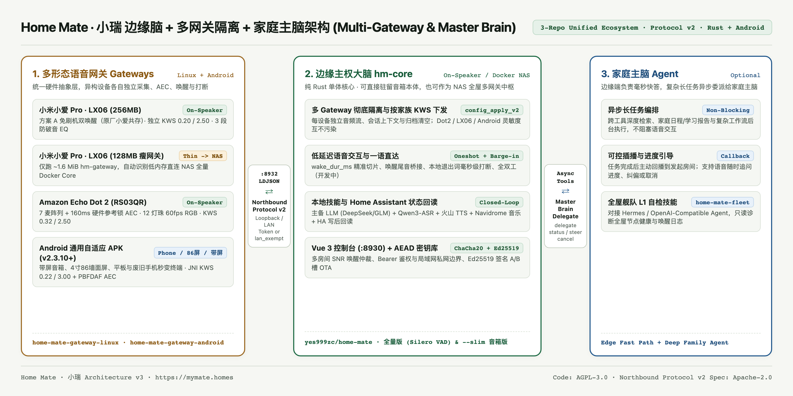

<div align="center">
  <h1>Home Mate Linux 统一硬件语音网关</h1>
  <p>
    <strong>自适应多板卡 Rust 嵌入式 Linux 硬件语音网关</strong>
  </p>
  <p>
    <em>正式合并原 Echo Dot 2（<code>board-dot2</code>）与小米小爱音箱 Pro LX06（<code>board-lx06</code>，自适应 256 MB 本体双唤醒 / 128 MB 瘦网关）两套硬件实现，通过 Northbound Protocol v2 对接 Home Mate Core。</em>
  </p>
  <p>
    <a href="README.md">English</a> ·
    <a href="README.zh-CN.md"><strong>简体中文</strong></a> ·
    <a href="https://mymate.homes">官方网站 (mymate.homes)</a>
  </p>
  <p>
    
    
    
    
  </p>
</div>

> [!NOTE]
> **统一公开仓声明**：本仓库正式合并并替代此前独立维护的 `home-mate-gateway-dot2` 与 `home-mate-gateway-lx06` 仓库。后续所有 Echo Dot 2 与小米 LX06（256 MB / 128 MB 自适应）固件构建、声学优化与 AI 部署脚本均在本仓统一发布。

---

## 生态定位与架构边界

<p align="center">
  
</p>

本仓库是 **Home Mate** 统一三仓开源生态中的 **Linux 嵌入式多板卡硬件语音网关**：

| 仓库 | 定位 | 关系 |
| :--- | :--- | :--- |
| **[`yes999zc/home-mate`](https://github.com/yes999zc/home-mate)** | 核心边缘大脑（`hm-core` 全量版 / `--slim` 精简版 + Vue 3 控制台 + 家庭主脑委派 + Docker/NAS） | 监听 Northbound v2 TCP `:8932`（音箱本机回环或局域网 NAS Docker） |
| **`yes999zc/home-mate-gateway-linux`** *（本仓）* | Linux 统一多板卡硬件语音网关 | 独占/共享 ALSA、多麦 SpeexDSP AEC、离线 KWS 侧车（一语直达与本地退场）、灯环、实体按键与非侵入式守护进程 |
| **[`yes999zc/home-mate-gateway-android`](https://github.com/yes999zc/home-mate-gateway-android)** | Android 通用自适应 APK | 适配带屏音箱、4 寸 86 墙面屏、平板、主力机与废旧安卓手机 |

**严格硬件与声学隔离原则**：
- 核心 `hm-core` 不包含任何硬件驱动分支；Linux 音箱全部通过本仓的 `Hardware` Trait + `DeviceProfile` + Cargo Feature 门控（`board-dot2` / `board-lx06`）适配，不同板卡编译期零冗余。
- **分硬件家族 KWS 隔离与 `config_apply_v2`**：**LX06**（`0.20 / 2.50`）与 **Android**（`0.22 / 3.00`）自带独立硬件家族默认灵敏度，**Dot2** 代码/侧车默认值为 `0.25 / 3.00`（实机标定生产基线 `0.32 / 2.50`），多房互不污染；运行期 KWS/EQ/LED/声学参数通过北向 **`config_apply_v2`** 协议下发，其中 KWS 采用延迟生效回执（`Persisted` -> 仅在 `hm-kws` 就绪回报后确认 `Active`，20 秒单调时钟超时保护）。单机音量上限、混音比例与 VAD 门限按单台实测保存，不跨机复制。
- **低延迟语音管线**：支持一语直达 `wake_dur_ms` 精准切片、唤醒应答尾音桥接、确定性本地退出词冲刷（`退下吧` / `停止播放` —— 播放期间严格先发 `LocalExitFlushed` 再发退场 `Keyword` 帧）及播中热词打断（日常默认稳定半双工；全双工正在开发中）。

---

## 三大设备目标与自适应部署模式

> **小米 LX06 部署前必查内存**：小米小爱音箱 Pro（`LX06`）存在 **256 MB 内存** 与 **128 MB 内存** 两种出厂批次！部署前请先 SSH 执行 `free -m` 或 `grep ^MemTotal /proc/meminfo`，`init.sh` 也会自动识别并分流：

| 目标形态 | 硬件型号与内存规格 | 目标架构与 Cargo Feature | 运行形态 | Core 位置与连接方式 |
| :--- | :--- | :--- | :--- | :--- |
| **目标 1：Amazon Echo Dot 2 (`dot2`)** | Echo Dot 2 (`AEOBC` / `RS03QR`), 512 MB RAM | `armv7-unknown-linux-musleabihf`<br/>`board-dot2`（默认）+ `clock32` | 本机独立运行：全量 `hm-core` + `hm-gateway` + 本地 `hm-kws`（代码默认 `0.25/3.00`；实机标定基线 `0.32/2.50`），7 麦 + ch8 回环 AEC、12 颗灯环、A/B 槽 OTA | **音箱本机** 全量 `hm-core`，回环 `127.0.0.1:8932` |
| **目标 2：小米小爱 Pro `LX06` 256 MB (`lx06-256m`)** | `LX06` 256 MB 批次（`MemTotal >= 180,000 kB`，`/tmp` 约 120 MiB） | `aarch64-unknown-linux-musl`<br/>`--no-default-features --features board-lx06` | 本机独立双唤醒：`hm-core --slim` + `hm-gateway` + 本地 `hm-kws`（`0.20/2.50`，`gateway_vad`），方案 A（零改动 SquashFS），与原厂小爱共存 | **音箱本机** `hm-core --slim`，回环 `127.0.0.1:8932` |
| **目标 3A：小米小爱 Pro `LX06` 128 MB 瘦网关（推荐有 NAS）** | `LX06` 128 MB 批次（`MemTotal < 180,000 kB`，约 118 MB RAM、`/tmp` 约 59 MiB） | `aarch64-unknown-linux-musl`<br/>`--no-default-features --features board-lx06` | 仅网关瘦客户端：`hm-lx06-thin.tar.xz`（压缩 ~606 KB / 运行仅 ~4 MiB RAM），不跑本机 `hm-core` 与 `hm-kws`，零改动 SquashFS | **局域网 NAS / 服务器上的全量 Docker `hm-core`**（带 Silero VAD，直连局域网 `:8932` 或 SSH 反向隧道） |
| **目标 3B：小米小爱 Pro `LX06` 128 MB 无 NAS 单机纯 ASR（尝鲜）** | `LX06` 128 MB 批次（`MemTotal < 180,000 kB`，无 NAS/服务器） | `aarch64-unknown-linux-musl`<br/>`--no-default-features --features board-lx06` | 本机纯 ASR：`hm-core --slim`（`HM_VOICE_EVENTS=0`，能量 VAD + 云端 ASR 唤醒）+ `hm-gateway`，**跳过 `hm-kws`**（净吃 ~26–31 MiB RAM，余量 ~22–30 MiB），零改动 SquashFS | **音箱本机** `hm-core --slim`，回环 `127.0.0.1:8932`（无需 NAS） |

> **关于非 Pro 版小爱音箱**：目前仅内置验证 **LX06（小米小爱音箱 Pro）**；非 Pro 型号可参考文末 [移植新 Linux 音箱指南](#移植新-linux-音箱指南)。

---

## 分目标部署说明

### 目标 1：Amazon Echo Dot 2 (`dot2`)
- **前提条件**：已解锁 Bootrom 并刷入自定义 emOS（如 `firebreak` / `amonet`）。
- **构建命令**：`./tools/build_firmware.sh`（使用 `rust-lld` + Rust musl `mallocng` 链接，并强制过 `elf_assert.py` 与 16 MiB 体积门禁）。

### 目标 2：小米小爱音箱 Pro `LX06` 256 MB (`lx06-256m`)
- **前提条件**：已通过 [idootop/open-xiaoai](https://github.com/idootop/open-xiaoai) 开启 Root SSH，`MemTotal >= 180,000 kB`，且 `/data` 剩余空间 `>= 6.0 MiB`（`df -h /data`）。
- **零变砖方案 A**：原厂 `mtd4 / mtd5` SquashFS **0 字节改动**；随时执行 `ssh root@192.168.1.10 'rm -rf /data/hm /data/init.sh && reboot'` 恢复纯原厂小爱。
- **打包与安装**：
  ```bash
  ./tools/pack_lx06_bundle.sh
  # 在局域网 HTTP 托管 build/lx06/hm-kws-lx06.tar.xz 后安装：
  ./deploy/lx06/install-lx06.sh \
    --device-ip 192.168.1.10 \
    --kws-url http://192.168.1.50:18089/hm-kws-lx06.tar.xz
  ```
- **控制台与切换**：访问 `http://192.168.1.10:8930`；长按音箱顶部「播放/暂停」键 1.5 秒（`lx06-switch-watch`）即可在双唤醒（`homemate`）与原厂小爱独占模式（`xiaoai-pinned`）间自由切换。

### 目标 3：小米小爱音箱 Pro `LX06` 128 MB 批次（双方案可选：有 NAS 瘦网关 / 无 NAS 单机纯 ASR）

> **社区致谢**：特别感谢 **[@jiantongzh](https://github.com/jiantongzh)** 实机验证 128 MB 批次 LX06 规格并贡献最初的 Thin Mode 瘦网关设计！
> **免编译直装**：`v0.0.54` 起 GitHub Releases 已同时挂载预编译成品包（`hm-lx06-thin.tar.xz` 约 `606 KB`、`hm-bundle.tar.xz` 约 `5.0 MiB`、`init.sh`、`unxz` 与 `SHA256SUMS.txt`），**无需安装 Rust 交叉编译工具链即可直接下载安装**。

#### 方案 3A（推荐，家里有 NAS / 电脑 / 软路由）：128 MB 瘦网关 (`--thin`) + NAS 全量 Docker `hm-core`
音箱端只跑 `hm-gateway`（仅吃 `~4 MiB` RAM，富裕 `~50 MiB`），由局域网 NAS/服务器上的**标准全量版 Docker `hm-core`**（内置 Silero 神经网络 VAD，切勿使用 `--slim`）处理对话与语音：

```bash
# 1. 在 NAS / 服务器部署标准全量版 Docker hm-core（开启 HM_GATEWAY_ALLOW_LAN=1，并在 :8930 配对令牌）
git clone https://github.com/yes999zc/home-mate.git && cd home-mate && docker compose up -d

# 2. 免编译下载 v0.0.54 瘦网关成品包并安装到 128 MB LX06（也可运行 ./tools/pack_lx06_bundle.sh --thin 自行编译）
git clone https://github.com/yes999zc/home-mate-gateway-linux.git && cd home-mate-gateway-linux
mkdir -p build/lx06
for f in hm-lx06-thin.tar.xz hm-lx06-thin.sha256 init.sh unxz SHA256SUMS.txt; do
  curl -fL "https://github.com/yes999zc/home-mate-gateway-linux/releases/download/v0.0.54/$f" -o "build/lx06/$f"
done
chmod +x build/lx06/init.sh build/lx06/unxz
./deploy/lx06/install-lx06.sh \
  --thin \
  --device-ip 192.168.1.10 \
  --core-addr 192.168.1.50:8932 \
  --device-id lx06-livingroom \
  --core-token "<NAS控制台配对令牌>"
```
*（`--allow-lan-core` 仍严格仅放行回环 + RFC 1918 私网 + Tailscale `100.64/10` + IPv6 ULA `fc00::/7`，**永远拒绝公网 IP**；`--core-token` 以 `chmod 600` 存入 `/data/hm/core.token` 并通过环境变量注入。省略 `--core-addr` 则走 SSH 反向隧道 `127.0.0.1:8932`。）*

#### 方案 3B（无 NAS 单机尝鲜）：128 MB 本机纯 ASR 模式 (`--standalone-asr`)
如果手里**没有 NAS / 常开服务器**，128 MB LX06 也可以直接跳过吃掉 `50~68 MiB` 内存的本地 `hm-kws`，在本机独立运行 **`hm-core --slim`（自动禁用 `/tmp/hm-voice-events` 防撑爆 58 MB `/tmp`）+ `hm-gateway` + `:8930` 控制台**（合计净吃 `~26–31 MiB` RAM，保留 `~22–30 MiB` 安全余量，`/data` 需 ≥ `5.5 MiB` 空闲）：

```bash
# 1. 免编译下载 v0.0.54 主包（也可运行 ./tools/pack_lx06_bundle.sh --standalone-asr 自行编译）
git clone https://github.com/yes999zc/home-mate-gateway-linux.git && cd home-mate-gateway-linux
mkdir -p build/lx06
for f in hm-bundle.tar.xz hm-bundle.sha256 init.sh unxz SHA256SUMS.txt; do
  curl -fL "https://github.com/yes999zc/home-mate-gateway-linux/releases/download/v0.0.54/$f" -o "build/lx06/$f"
done
chmod +x build/lx06/init.sh build/lx06/unxz

# 2. 一键安装到 128 MB LX06（零 NAS 依赖，安装完直接访问 http://192.168.1.10:8930）
./deploy/lx06/install-lx06.sh \
  --standalone-asr \
  --device-ip 192.168.1.10 \
  --device-id lx06-standalone
```

#### 128 MB 两种模式的架构取舍（如实告知）
1. **方案 3A（瘦网关 + NAS）**：依赖局域网 NAS 与 Wi-Fi，无音箱端本地 KWS，但 NAS 侧拥有完整 **Silero 神经网络 VAD**（抗环境噪音准、不乱费 ASR 额度），且音箱内存最宽裕（剩 ~50 MiB）。
2. **方案 3B（无 NAS 单机纯 ASR）**：完全不依赖 NAS、开箱即用 `:8930` 控制台；但因关闭了 `hm-kws` 且 `--slim` 自动回退到**能量 VAD + 云端 ASR 唤醒**，存在以下取舍：① 电视/环境较吵时能量 VAD 容易误送背景音去云端 ASR；② 唤醒比本地 KWS 慢约 `0.5~1.5 秒`；③ 无本地热词打断/本地退出词，放歌期间语音打断较弱（可通过物理按键、控制台或手机 App 控播）。
3. **默认自动分流**：`deploy/lx06/init.sh` 在 `MemTotal < 180000` kB 时默认自动进入安全的瘦模式（3A）；仅当显式写入 `/data/hm/standalone-asr`（由 `--standalone-asr` 安装）或 `HM_STANDALONE_ASR=1` 时启用单机纯 ASR 模式（3B）。

---

## AI 编程助手一键部署提示词

### 提示词 A：小米小爱音箱 Pro (`LX06`) 智能自适应部署（256 MB / 128 MB 三模式自动分流）
```text
请帮我把 Home Mate 部署到我的小米小爱音箱 Pro（LX06），音箱局域网 IP 是 192.168.1.10（已通过 open-xiaoai 开启 root SSH）；如果我有局域网 NAS/服务器，IP 是 192.168.1.50（若没有 NAS，请告知我改走 128 MB 无 NAS 单机纯 ASR 模式）。

请严格遵守以下安全与架构规则：
1. 严禁修改原厂 SquashFS 分区（mtd4 / mtd5），仅允许使用零变砖的方案 A（只写 /data/hm 与 /data/init.sh）。
2. 第一步必须先 SSH 登录 root@192.168.1.10，执行 `free -m`、`grep ^MemTotal /proc/meminfo` 和 `df -h /data /tmp`，根据实测内存自动分流：
   - 若 MemTotal >= 180000 kB（256 MB 批次 -> 目标 2 本机独立双唤醒）：
     a) 确认 /data 剩余 >= 6 MiB，执行 `./tools/pack_lx06_bundle.sh` 打包（或下载 Release 成品包），并在局域网 HTTP 托管 `build/lx06/hm-kws-lx06.tar.xz`。
     b) 执行 `./deploy/lx06/install-lx06.sh --device-ip 192.168.1.10 --kws-url http://192.168.1.50:18089/hm-kws-lx06.tar.xz` 安装。
     c) 验证音箱上 `hm-core`、`hm-gateway`、`hm-kws` 均在线，`http://192.168.1.10:8930` 返回 200，且 `/api/v0/mode` 显示 LX06 灵敏度 `0.20 / 2.50`。
   - 若 MemTotal < 180000 kB（128 MB 批次）：
     * 【优先·有 NAS -> 方案 3A 瘦网关模式】：
       a) 先在 NAS/服务器（192.168.1.50）部署 `yes999zc/home-mate` 标准全量版（FULL）Docker `hm-core`（切勿用 `--slim`，开启 `HM_GATEWAY_ALLOW_LAN=1` 并配对管理员令牌）。
       b) 从 `yes999zc/home-mate-gateway-linux` 最新 Release（v0.0.54+）直接下载 `hm-lx06-thin.tar.xz`、`hm-lx06-thin.sha256`、`init.sh`、`unxz` 到 `build/lx06/`（无需 Rust 编译），执行 `./deploy/lx06/install-lx06.sh --thin --device-ip 192.168.1.10 --core-addr 192.168.1.50:8932 --core-token "<令牌>"`。
       c) 验证音箱只运行 `hm-gateway` 且在 `http://192.168.1.50:8930` 显示在线。
     * 【无 NAS 尝鲜 -> 方案 3B 本机纯 ASR 模式】：
       a) 确认 `/data` 剩余 >= 5.5 MiB，从最新 Release（v0.0.54+）下载 `hm-bundle.tar.xz`、`hm-bundle.sha256`、`init.sh`、`unxz` 到 `build/lx06/`（免编译），执行 `./deploy/lx06/install-lx06.sh --standalone-asr --device-ip 192.168.1.10`。
       b) 验证音箱只运行 `hm-core`（含 `HM_VOICE_EVENTS=0`）与 `hm-gateway`（无 `hm-kws`）、`/tmp` 占用 < 45%、且 `http://192.168.1.10:8930` 返回 200。
3. 严禁把任何真实 IP、Token 或密钥写入 Git；操作 NAS 重启或已有服务前请先征求我的确认。
```

### 提示词 B：已知 128 MB 批次 `LX06`（免编译直装：有 NAS 瘦网关 / 无 NAS 单机纯 ASR）
```text
我确认我的小米小爱音箱 Pro（LX06，IP 192.168.1.10）是 128 MB 内存批次（MemTotal 约 118 MB，/tmp 约 59 MB）。请直接下载 `yes999zc/home-mate-gateway-linux` 最新 Release（v0.0.54+）预编译包（无需本地编译 Rust），按我手头环境二选一完成部署（绝不触碰原厂 SquashFS `mtd4`/`mtd5`）：

- 选项 1（我有 NAS/电脑，IP 192.168.1.50，推荐）：
  1. 在 NAS 部署 `yes999zc/home-mate` 标准全量版 Docker `hm-core`（不要用 `--slim`，开启 `HM_GATEWAY_ALLOW_LAN=1`，开放 8930/8932/8933-udp）并立即配对管理员令牌。
  2. 下载 `hm-lx06-thin.tar.xz`、`hm-lx06-thin.sha256`、`init.sh`、`unxz` 到 `build/lx06/` 并校验 SHA-256。
  3. 执行 `./deploy/lx06/install-lx06.sh --thin --device-ip 192.168.1.10 --core-addr 192.168.1.50:8932 --device-id lx06-room1 --core-token "<令牌>"`。
  4. 验证 `/tmp/hm-gateway.log` 握手成功且音箱出现在 `http://192.168.1.50:8930`。

- 选项 2（我没有 NAS，想先在 128 MB 音箱上单机纯 ASR 尝鲜）：
  1. 确认音箱 `/data` 剩余空间 >= 5.5 MiB。
  2. 下载 `hm-bundle.tar.xz`、`hm-bundle.sha256`、`init.sh`、`unxz` 到 `build/lx06/` 并校验 SHA-256。
  3. 执行 `./deploy/lx06/install-lx06.sh --standalone-asr --device-ip 192.168.1.10 --device-id lx06-standalone`。
  4. 验证音箱仅运行 `hm-core`（`HM_VOICE_EVENTS=0`）和 `hm-gateway`（不运行 `hm-kws`），`http://192.168.1.10:8930` 返回 200，并提醒我该模式使用能量 VAD + 云端 ASR 唤醒。
```

### 提示词 C：Amazon Echo Dot 2 (`dot2`) 编译与本地验证
```text
请帮我编译并验证 Amazon Echo Dot 2（目标 1，`board-dot2`，`armv7-unknown-linux-musleabihf`）版本的 Home Mate Linux Device Gateway：

1. 切勿直接手打 `cargo zigbuild`（Zig 自带 musl 的 SmpAllocator 会导致设备端 RSS 持续上涨触发 OOM），请务必使用 `./tools/build_firmware.sh`（使用 `rust-lld` + Rust musl `mallocng`，自动执行 `elf_assert.py` 与 16 MiB `size_gate.py`）。
2. 编译前先执行本地校验：`python3 tools/line_gate.py`、`cargo fmt --all -- --check`、三矩阵 `cargo clippy -- -D warnings` 与 `cargo test --workspace --locked -- --test-threads=1`。
3. 与 `yes999zc/home-mate` 的全量版 `hm-core`（`./tools/build_core.sh`，回环 `127.0.0.1:8932`）配套部署，声学参数按单台实测配置，切勿跨机复制。
```

---

## 本地构建与测试

> **关键构建规则**：所有发布二进制必须通过 `tools/build_firmware*.sh` 构建（`zig cc` 编译 C 依赖 + `rust-lld` 最终链接 Rust musl `mallocng`），**切勿直接手打 `cargo zigbuild`**。

```bash
# 1. 主机三矩阵校验与测试（Rust 1.100+）
python3 tools/line_gate.py
python3 tools/size_gate.py --self-test
sh -n deploy/lx06/init.sh && sh -n deploy/lx06/install-lx06.sh && bash -n tools/pack_lx06_bundle.sh
python3 tools/test_lx06_supervisor.py
bash tools/slot_decision_test.sh

cargo fmt --all -- --check
cargo clippy --workspace --all-targets --locked -- -D warnings
cargo clippy --workspace --no-default-features --features board-lx06 --all-targets --locked -- -D warnings
cargo clippy --workspace --all-features --all-targets --locked -- -D warnings

cargo test --workspace --all-targets --locked -- --test-threads=1
cargo test --workspace --no-default-features --features board-lx06 --all-targets --locked -- --test-threads=1
cargo test --workspace --all-features --all-targets --locked -- --test-threads=1

# 2. 交叉编译设备固件与打包
./tools/build_firmware.sh          # 目标 1：Echo Dot 2 (armv7 + 16 MiB 门禁)
./tools/build_firmware_lx06.sh     # 目标 2/3：LX06 网关二进制 (aarch64)
./tools/pack_lx06_bundle.sh        # 目标 2：LX06 256 MB 方案 A 完整包 (<= 6.0 MiB)
./tools/pack_lx06_bundle.sh --thin           # 目标 3A：LX06 128 MB 瘦网关包 (<= 1.5 MiB)
./tools/pack_lx06_bundle.sh --standalone-asr # 目标 3B：LX06 128 MB 无 NAS 单机纯 ASR 包 (<= 6.0 MiB)
```

---

## 移植新 Linux 音箱指南

1. 在 `crates/gateway/Cargo.toml` 中新增 `board-<name>` Feature。
2. 在 `crates/gateway/src/firmware/` 下实现 `Hardware` Trait（ALSA 采集/播放、灯环、按键、Codec 初始化）。
3. 在 `crates/gateway/src/firmware/profile.rs` 中补充对应的 `DeviceProfile` 预设，并接入 `FirmwareConfig::apply_profile` 与 `open_hardware`。
4. 添加 `rust-lld` + Rust musl 交叉编译脚本并通过三矩阵 `clippy` / `test` 与体积门禁。

---

## 许可协议

与 [`yes999zc/home-mate`](https://github.com/yes999zc/home-mate) 保持统一双许可模型：
- **开源使用**：**GNU Affero General Public License v3.0 (`AGPL-3.0-only`)**（[`LICENSE`](LICENSE)）。
- **北向 v2 协议例外**：**Apache License 2.0**（[`LICENSE-PROTOCOL-APACHE-2.0`](LICENSE-PROTOCOL-APACHE-2.0)）。
- **商业授权 / OEM 预装**：请联系 `zhangcong1985@gmail.com` / `yes999zc@163.com`（官网：[https://mymate.homes](https://mymate.homes)）。
- 第三方依赖许可致谢见 [`THIRD_PARTY_NOTICES.md`](THIRD_PARTY_NOTICES.md)。
